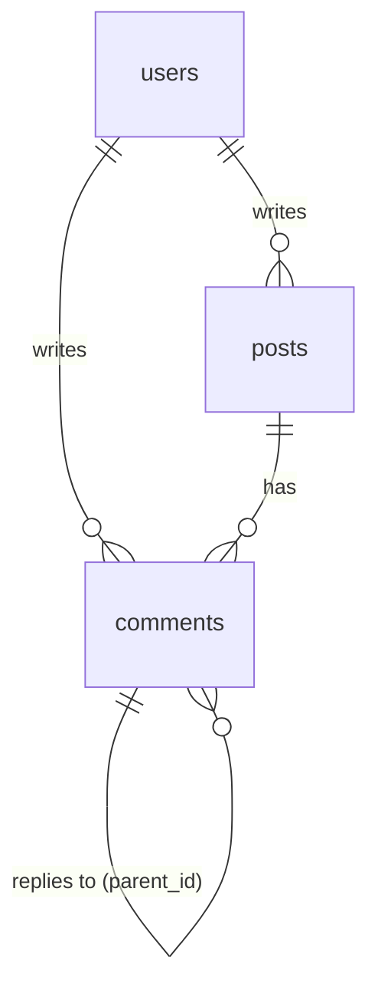

# 02 · Database schema + connection pool

[⬅ Index](./README.md) · [⬅ Prev](./01-hello-server-and-env.md) · [Next ➡ 03 Express app/server](./03-express-app-and-server.md)

## 🎯 Goal

Design the three core tables (`users`, `posts`, `comments`) and create a reusable MySQL connection pool.

## 🔖 Commits

| Hash | Message |
| --- | --- |
| `79f2c63` | add config/db.js |
| `f72abbc` | fix(db): export the connection pool from config/db.js |

## 🗂️ Files

| File | Action |
| --- | --- |
| `sql/schema.sql` | created |
| `src/config/db.js` | created, then fixed to export the pool |

## 🛠️ Walkthrough

### 1. Install the driver

```bash
npm install mysql2
```

### 2. Create the database

```sql
CREATE DATABASE simple_weblog CHARACTER SET utf8mb4;
```

### 3. `sql/schema.sql`: first version

This was the original, fuller version. [Step 05](./05-otps-table-and-schema-simplify.md) simplifies it for local development.

```sql
CREATE TABLE IF NOT EXISTS users (
  id INT UNSIGNED AUTO_INCREMENT PRIMARY KEY,
  phone VARCHAR(11) NOT NULL UNIQUE,
  name VARCHAR(100) NOT NULL DEFAULT '',
  role ENUM('author', 'admin') NOT NULL DEFAULT 'author',
  created_at TIMESTAMP NOT NULL DEFAULT CURRENT_TIMESTAMP
) ENGINE=InnoDB DEFAULT CHARSET=utf8mb4;

CREATE TABLE IF NOT EXISTS posts (
  id INT UNSIGNED AUTO_INCREMENT PRIMARY KEY,
  author_id INT UNSIGNED NOT NULL,
  title VARCHAR(200) NOT NULL,
  body TEXT NOT NULL,
  created_at TIMESTAMP NOT NULL DEFAULT CURRENT_TIMESTAMP,
  updated_at TIMESTAMP NOT NULL DEFAULT CURRENT_TIMESTAMP ON UPDATE CURRENT_TIMESTAMP,
  INDEX idx_posts_created (created_at),
  CONSTRAINT fk_posts_author FOREIGN KEY (author_id) REFERENCES users(id) ON DELETE CASCADE
) ENGINE=InnoDB DEFAULT CHARSET=utf8mb4;

CREATE TABLE IF NOT EXISTS comments (
  id INT UNSIGNED AUTO_INCREMENT PRIMARY KEY,
  post_id INT UNSIGNED NOT NULL,
  user_id INT UNSIGNED NOT NULL,
  parent_id INT UNSIGNED NULL,
  body TEXT NOT NULL,
  created_at TIMESTAMP NOT NULL DEFAULT CURRENT_TIMESTAMP,
  CONSTRAINT fk_comments_post FOREIGN KEY (post_id) REFERENCES posts(id) ON DELETE CASCADE,
  CONSTRAINT fk_comments_user FOREIGN KEY (user_id) REFERENCES users(id) ON DELETE CASCADE,
  CONSTRAINT fk_comments_parent FOREIGN KEY (parent_id) REFERENCES comments(id) ON DELETE CASCADE
) ENGINE=InnoDB DEFAULT CHARSET=utf8mb4;
```

Entity relationships:



> [!TIP]
> `comments.parent_id` points at **the same table**. `NULL` means a top-level comment. That one column is what makes nested replies possible (step 11).

### 4. `src/config/db.js`: the pool

```js
const mysql = require('mysql2/promise');

const pool = mysql.createPool({
    host: process.env.DB_HOST,
    user: process.env.DB_USER,
    password: process.env.DB_PASSWORD,
    database: process.env.DB_NAME,
    waitForConnections: true,
    connectionLimit: 10,
});

module.exports = pool;
```

> [!CAUTION]
> The first version of this file (`79f2c63`) **forgot `module.exports = pool;`**. `require('./config/db')` then returned `{}` and `pool.query` crashed. Fixed in `f72abbc`.

### 5. Import the schema

```bash
mysql -u <user> -p simple_weblog < sql/schema.sql
```

## ✅ Verify

```bash
mysql -u <user> -p simple_weblog -e "SHOW TABLES;"
# comments, posts, users
```

## 🧠 Why a pool?

| Without a pool | With a pool |
| --- | --- |
| Open a new TCP connection per request | Reuse up to `connectionLimit` open connections |
| Slow and easy to exhaust | `waitForConnections: true` queues requests when all are busy |
