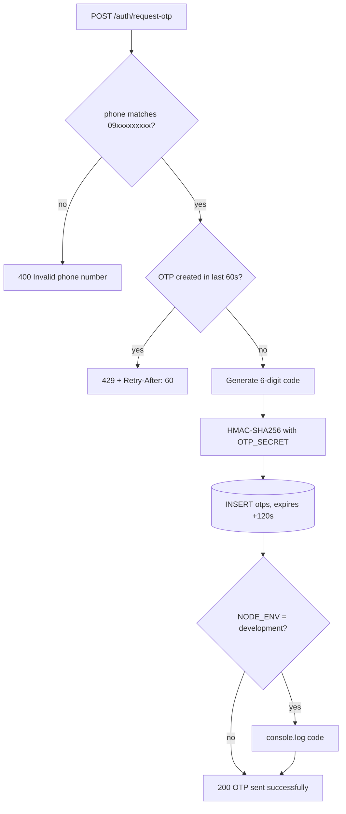

# 06 · Request OTP

[⬅ Index](./README.md) · [⬅ Prev](./05-otps-table-and-schema-simplify.md) · [Next ➡ 07 Verify OTP + JWT](./07-verify-otp-and-jwt.md)

## 🎯 Goal

`POST /auth/request-otp`: validate a phone number, enforce a 60-second cooldown, generate a 6-digit code, store **only its hash**, and (in development) print the code to the console.

## 🔖 Commits

| Hash | Message |
| --- | --- |
| `3eaeaf7` | feat(auth): implement request-otp endpoint with cooldown |

## 🗂️ Files

| File | Action |
| --- | --- |
| `src/routes/auth.js` | created |
| `src/app.js` | mount `authRouter` at `/auth` |

## 🛠️ Walkthrough

### 1. Flow



### 2. `src/routes/auth.js`: start of the file

```js
const express = require('express');
const crypto = require('crypto');
const pool = require('../config/db');
const router = express.Router();

router.post('/request-otp', async (req, res) => {
    const { phone } = req.body;

    // 1. Validate Iranian phone number format (09xxxxxxxxx)
    if (!phone || !/^09\d{9}$/.test(phone)) {
        return res.status(400).json({ error: 'Invalid phone number' });
    }

    // 2. Cooldown check: prevent sending another code within 60 seconds
    const [recentOtps] = await pool.query(
        `SELECT created_at FROM otps 
         WHERE phone = ? AND created_at > NOW() - INTERVAL 60 SECOND 
         ORDER BY id DESC LIMIT 1`,
        [phone]
    );

    if (recentOtps.length > 0) {
        res.set('Retry-After', '60');
        return res.status(429).json({ error: 'Please wait before requesting another code' });
    }

    // 3. Generate a 6-digit random code and calculate its HMAC hash
    const code = String(crypto.randomInt(100000, 1000000));
    const codeHash = crypto
        .createHmac('sha256', process.env.OTP_SECRET)
        .update(code)
        .digest('hex');

    // 4. Save hash to database with 120s expiration
    await pool.query(
        `INSERT INTO otps (phone, code_hash, expires_at) 
         VALUES (?, ?, NOW() + INTERVAL 120 SECOND)`,
        [phone, codeHash]
    );

    // 5. In development, log the plain code to test easily
    if (process.env.NODE_ENV === 'development') {
        console.log(`[DEV OTP] Phone: ${phone} | Code: ${code}`);
    }

    res.json({ message: 'OTP sent successfully' });
});

module.exports = router;
```

### 3. Mount it in `src/app.js`

```diff
 const errorHandler = require('./middleware/errorHandler');
+const authRouter = require('./routes/auth');
 const app = express();
 ...
 app.use(express.json());
+app.use('/auth', authRouter);
 app.get('/health', ...
```

### 4. Decisions worth remembering

| Decision | Reason |
| --- | --- |
| `crypto.randomInt(100000, 1000000)` | Cryptographically secure. `Math.random()` is guessable |
| Range starts at `100000` | The code is always exactly 6 digits, no leading zeros to lose |
| HMAC with `OTP_SECRET`, not a plain SHA | A 6-digit code has only 1M values. A plain hash can be brute-forced instantly. A keyed HMAC can't be without the secret |
| `NOW()` and `INTERVAL` in SQL | Uses the **database clock** for all time checks, so the app and DB can't disagree |
| `Retry-After: 60` header | Tells clients how long to wait |
| Same response whether or not the user exists | Doesn't reveal which phones are registered |

### 5. Run in dev mode

Add `NODE_ENV=development` to your `.env` to see the code in the console:

```dotenv
NODE_ENV=development
```

> [!CAUTION]
> The plain code is logged **only** when `NODE_ENV === 'development'`. Never set that in production, or codes end up in logs.

> [!NOTE]
> There is no real SMS provider. The code only reaches the console. Plug in an SMS service at step 5 of the handler when needed.

## ✅ Verify

```bash
# 1. invalid phone
curl -X POST localhost:3000/auth/request-otp \
  -H 'Content-Type: application/json' -d '{"phone":"123"}'
# 400 {"error":"Invalid phone number"}

# 2. valid phone
curl -X POST localhost:3000/auth/request-otp \
  -H 'Content-Type: application/json' -d '{"phone":"09123456789"}'
# {"message":"OTP sent successfully"}
# server console: [DEV OTP] Phone: 09123456789 | Code: 482913

# 3. immediately again → cooldown
# 429 {"error":"Please wait before requesting another code"}
```

## ⚠️ Gotchas

- The cooldown query uses `created_at`. The column must exist with `DEFAULT CURRENT_TIMESTAMP` (step 05).
- `req.body` is `undefined` if the client forgets `Content-Type: application/json`, and destructuring it throws. Always send the header when testing.
