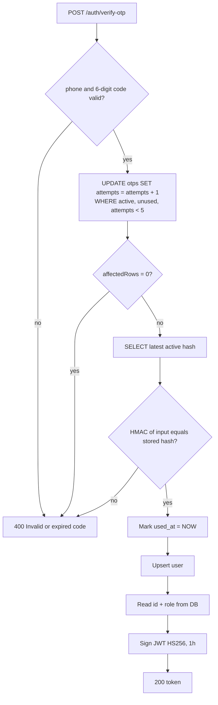

# 07 · Verify OTP + JWT

[⬅ Index](./README.md) · [⬅ Prev](./06-request-otp.md) · [Next ➡ 08 Auth middleware](./08-auth-middleware.md)

## 🎯 Goal

`POST /auth/verify-otp`: check the code safely (limited attempts, one-time use), create the user on first login, and return a signed JWT.

## 🔖 Commits

| Hash | Message |
| --- | --- |
| `1529431` | feat(auth): implement verify-otp endpoint and JWT generation |

## 🗂️ Files

| File | Action |
| --- | --- |
| `src/routes/auth.js` | `verify-otp` route + `jsonwebtoken` import |
| `package.json` / lock | `jsonwebtoken` added |

## 🛠️ Walkthrough

### 1. Install

```bash
npm install jsonwebtoken
```

### 2. Add the import at the top of `src/routes/auth.js`

```diff
 const pool = require('../config/db');
+const jwt = require('jsonwebtoken');
 const router = express.Router();
```

### 3. Flow



### 4. The route

Add this below `request-otp`:

```js
router.post('/verify-otp', async (req, res) => {
    const { phone, code } = req.body;

    // 1. Basic validation
    if (!phone || !/^09\d{9}$/.test(phone) || !code || !/^\d{6}$/.test(code)) {
        return res.status(400).json({ error: 'Invalid or expired code' });
    }

    // 2. Consume one attempt atomically (max 5 attempts, must be active and unused)
    const [updateResult] = await pool.query(
        `UPDATE otps 
         SET attempts = attempts + 1 
         WHERE phone = ? AND used_at IS NULL AND expires_at > NOW() AND attempts < 5 
         ORDER BY id DESC LIMIT 1`,
        [phone]
    );

    if (updateResult.affectedRows === 0) {
        return res.status(400).json({ error: 'Invalid or expired code' });
    }

    // 3. Fetch the latest active OTP hash
    const [rows] = await pool.query(
        `SELECT id, code_hash FROM otps 
         WHERE phone = ? AND used_at IS NULL AND expires_at > NOW() 
         ORDER BY id DESC LIMIT 1`,
        [phone]
    );

    if (rows.length === 0) {
        return res.status(400).json({ error: 'Invalid or expired code' });
    }

    const otp = rows[0];

    // 4. Compare HMAC hash
    const inputHash = crypto
        .createHmac('sha256', process.env.OTP_SECRET)
        .update(String(code))
        .digest('hex');

    if (inputHash !== otp.code_hash) {
        return res.status(400).json({ error: 'Invalid or expired code' });
    }

    // 5. Mark OTP as used so it cannot be used again
    await pool.query(
        `UPDATE otps SET used_at = NOW() WHERE id = ? AND used_at IS NULL`,
        [otp.id]
    );

    // 6. Ensure user exists (insert if new, ignore if existing)
    await pool.query(
        `INSERT INTO users (phone) VALUES (?) 
         ON DUPLICATE KEY UPDATE id = LAST_INSERT_ID(id)`,
        [phone]
    );

    // 7. Get user id and role strictly from DB
    const [users] = await pool.query(
        `SELECT id, role FROM users WHERE phone = ?`,
        [phone]
    );
    const user = users[0];

    // 8. Sign JWT (HS256, 1h)
    const token = jwt.sign(
        { sub: user.id, role: user.role },
        process.env.JWT_SECRET,
        { algorithm: 'HS256', expiresIn: '1h' }
    );

    res.json({ token });
});
```

### 5. Why each step is the way it is

| Step | Why |
| --- | --- |
| **One generic error** for every failure | The client can't tell "wrong code" from "expired" from "no such phone" |
| **Increment attempts *first*, then compare** | The attempt is spent even if the code is wrong. An attacker gets at most 5 guesses out of 1,000,000 |
| `UPDATE ... WHERE attempts < 5` | The check and the increment are **one atomic SQL statement**. Parallel requests can't squeeze in extra guesses |
| `WHERE ... used_at IS NULL` on the final update | A code can only be consumed once, even with a race |
| `ON DUPLICATE KEY UPDATE id = LAST_INSERT_ID(id)` | Creates the user if new and does nothing harmful if they exist, in one query, with no race between check and insert |
| Role read **from the DB** | The client never decides its own role |
| `{ sub, role }` payload | `sub` is the standard claim for "subject" (user id) |
| `algorithm: 'HS256'`, `expiresIn: '1h'` | Explicit algorithm, short-lived token |

### 6. The JWT payload

```json
{
  "sub": 1,
  "role": "author",
  "iat": 1731000000,
  "exp": 1731003600
}
```

## ✅ Verify

```bash
# 1. ask for a code, then read it from the server console
curl -X POST localhost:3000/auth/request-otp \
  -H 'Content-Type: application/json' -d '{"phone":"09123456789"}'

# 2. exchange it for a token
curl -X POST localhost:3000/auth/verify-otp \
  -H 'Content-Type: application/json' \
  -d '{"phone":"09123456789","code":"482913"}'
# {"token":"eyJhbGciOiJIUzI1NiIs..."}

# 3. same code again → rejected (single use)
# 400 {"error":"Invalid or expired code"}
```

> [!TIP]
> Paste the token into [jwt.io](https://jwt.io) to inspect the payload. Never paste production tokens there.

## ⚠️ Gotchas

- Make a user an admin by hand. There is no endpoint for it:
  ```sql
  UPDATE users SET role = 'admin' WHERE phone = '09123456789';
  ```
  Then log in again, because the **old token still says `author`**.
- Wrong-code attempts burn the budget for the latest OTP. After 5 wrong tries the user must request a new code.
