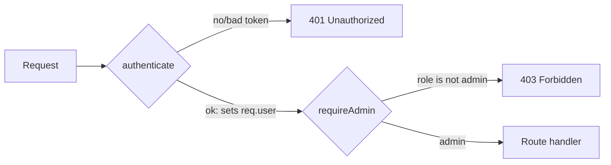

# 08 · Auth middleware + `/me`

[⬅ Index](./README.md) · [⬅ Prev](./07-verify-otp-and-jwt.md) · [Next ➡ 09 Posts CRUD](./09-posts-crud.md)

## 🎯 Goal

Create reusable middleware that turns a `Bearer` token into `req.user`, plus an admin-only guard, and prove it with `GET /auth/me`.

## 🔖 Commits

| Hash | Message |
| --- | --- |
| `6c2750b` | feat(auth): add authenticate and requireAdmin middlewares with /me route |

## 🗂️ Files

| File | Action |
| --- | --- |
| `src/middleware/auth.js` | created |
| `src/routes/auth.js` | import `authenticate`, add `GET /me` |

## 🛠️ Walkthrough

### 1. How the middleware chain works



| Code | Meaning |
| :-: | --- |
| **401** | "I don't know who you are" (missing, invalid or expired token) |
| **403** | "I know who you are, but you're not allowed" |

### 2. `src/middleware/auth.js`

```js
const jwt = require('jsonwebtoken');

function authenticate(req, res, next){
    const authHeader = req.headers['authorization'];
    // 1. check for bearer token structure
    if (!authHeader || !authHeader.startsWith('Bearer ')) {
        return res.status(401).json({ error: 'Unauthorized' });
    }
    const token = authHeader.split(' ')[1];

    // 2. verify token
    try {
        const decoded = jwt.verify(token, process.env.JWT_SECRET, {
            algorithms: ['HS256']
        });
        // 3. attach standard identity object to request
        req.user = {
            id: decoded.sub,
            role: decoded.role
        }

        next();
    } catch (err) {
        return res.status(401).json({ error: 'Unauthorized' });
    }
}

function requireAdmin(req, res, next) {
    if (!req.user || req.user.role !== 'admin'){
        return res.status(403).json({ error: 'Forbidden' });
    }
    next();
}

module.exports = { authenticate, requireAdmin };
```

### 3. Key details

| Detail | Why it matters |
| --- | --- |
| `algorithms: ['HS256']` in `verify` | Pins the algorithm. Blocks the classic `alg: none` and algorithm-swap attacks |
| Same generic `Unauthorized` for every failure | No hints for attackers |
| `req.user = { id, role }` | One stable shape that every route can rely on |
| `next()` is **inside** the `try` | If a downstream handler throws synchronously, the `catch` would wrongly turn it into a 401 |
| `requireAdmin` runs **after** `authenticate` | It only reads `req.user`. It never parses tokens |

> [!WARNING]
> `next()` inside the `try` block is a known small flaw. A synchronous throw from a later handler would be reported as 401. For a cleaner version, `next()` goes after the `try/catch`.
>
> ```js
> let decoded;
> try {
>   decoded = jwt.verify(token, process.env.JWT_SECRET, { algorithms: ['HS256'] });
> } catch {
>   return res.status(401).json({ error: 'Unauthorized' });
> }
> req.user = { id: decoded.sub, role: decoded.role };
> next();
> ```

### 4. Use it in `src/routes/auth.js`

```diff
 const jwt = require('jsonwebtoken');
 const router = express.Router();
+const { authenticate } = require('../middleware/auth');
```

Add at the bottom, before `module.exports`:

```js
router.get('/me', authenticate, (req, res) => {
    res.json({ user: req.user });
});
```

### 5. How to protect any route

```js
const { authenticate, requireAdmin } = require('../middleware/auth');

router.post('/',        authenticate,               createHandler);  // any logged-in user
router.delete('/:id',   authenticate, requireAdmin, deleteHandler);  // admins only
```

> [!NOTE]
> `requireAdmin` is exported but **no route uses it yet**. Posts handle author-or-admin ownership inside the SQL itself (step 09).

## ✅ Verify

```bash
TOKEN="<token from verify-otp>"

curl localhost:3000/auth/me
# 401 {"error":"Unauthorized"}

curl localhost:3000/auth/me -H "Authorization: Bearer $TOKEN"
# {"user":{"id":1,"role":"author"}}

curl localhost:3000/auth/me -H "Authorization: Bearer garbage"
# 401 {"error":"Unauthorized"}
```
