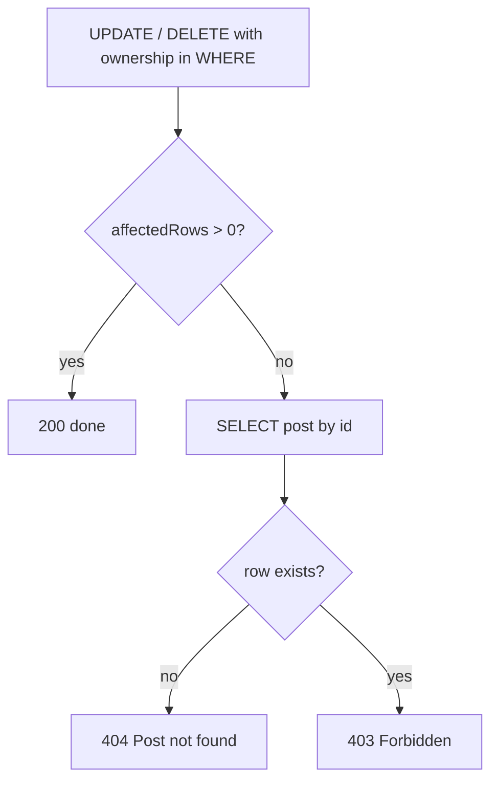

# 09 · Posts CRUD

[⬅ Index](./README.md) · [⬅ Prev](./08-auth-middleware.md) · [Next ➡ 10 Posts list](./10-posts-list-pagination-search.md)

## 🎯 Goal

Create, read, update and delete posts. Reads are public. Writes need a token. Edit and delete are limited to the **author or an admin**.

## 🔖 Commits

| Hash | Message |
| --- | --- |
| `cebd2ce` | feat(posts): add pagination and search to list endpoint |

> [!NOTE]
> That single commit added the whole `posts.js` file (CRUD **and** the list endpoint). This roadmap splits it in two so each part is easy to follow. The list endpoint is in [step 10](./10-posts-list-pagination-search.md).

## 🗂️ Files

| File | Action |
| --- | --- |
| `src/routes/posts.js` | created |

## 🛠️ Walkthrough

### 1. Endpoints in this step

| Method | Path | Auth | Success | Errors |
| --- | --- | :-: | :-: | --- |
| `POST` | `/posts` | ✅ | `201` | 400, 401 |
| `GET` | `/posts/:id` | public | `200` | 400, 404 |
| `PUT` | `/posts/:id` | ✅ author/admin | `200` | 400, 401, 403, 404 |
| `DELETE` | `/posts/:id` | ✅ author/admin | `200` | 400, 401, 403, 404 |

### 2. File header

```js
const express = require('express');
const pool = require('../config/db');
const { authenticate } = require('../middleware/auth');

const router = express.Router();
```

> [!WARNING]
> The repo's file has `const router = express();`, which creates a **whole sub-app** instead of a router. It happens to work when mounted, but `express.Router()` is the correct tool. Use `Router()` when you rebuild.

### 3. `POST /posts`: create

```js
// POST /posts - Create a new post
router.post('/', authenticate, async (req, res) => {
    const { title, body } = req.body;

    // 1. Validate inputs
    if (!title || typeof title !== 'string' || !title.trim()) {
        return res.status(400).json({ error: 'Title is required' });
    }
    if (!body || typeof body !== 'string' || !body.trim()) {
        return res.status(400).json({ error: 'Body is required' });
    }

    // 2. Insert post with authenticated user's ID
    const [result] = await pool.query(
        `INSERT INTO posts (author_id, title, body) VALUES (?, ?, ?)`,
        [req.user.id, title.trim(), body.trim()]
    );

    res.status(201).json({
        id: result.insertId,
        title: title.trim(),
        body: body.trim(),
        author_id: req.user.id
    });
});
```

| Point | Why |
| --- | --- |
| `author_id` from `req.user.id` | Never trust an `author_id` sent by the client |
| `typeof title !== 'string'` | Blocks arrays and objects (`{"title": ["x"]}`) |
| `.trim()` check | Rejects whitespace-only titles |
| `result.insertId` | MySQL's auto-increment id of the new row |

### 4. `GET /posts/:id`: read one

```js
// GET /posts/:id - Get a single post by ID
router.get('/:id', async (req, res) => {
    const { id } = req.params;

    // 1. Validate integer ID
    if (!/^\d+$/.test(id)) {
        return res.status(400).json({ error: 'Invalid post ID' });
    }

    // 2. Fetch post
    const [rows] = await pool.query(
        `SELECT id, author_id, title, body, created_at 
         FROM posts 
         WHERE id = ?`,
        [id]
    );

    if (rows.length === 0) {
        return res.status(404).json({ error: 'Post not found' });
    }
    res.json({ post: rows[0] });
});
```

### 5. `PUT /posts/:id`: update (author or admin)

```js
// PUT /posts/:id - Update post (author or admin only)
router.put('/:id', authenticate, async (req, res) => {
    const { id } = req.params;
    const { title, body } = req.body;

    // 1. Validate integer ID
    if (!/^\d+$/.test(id)) {
        return res.status(400).json({ error: 'Invalid post ID' });
    }

    // 2. Validate input fields
    if (!title || typeof title !== 'string' || !title.trim()) {
        return res.status(400).json({ error: 'Title is required' });
    }
    if (!body || typeof body !== 'string' || !body.trim()) {
        return res.status(400).json({ error: 'Body is required' });
    }

    // 3. Update with ownership check inside WHERE clause
    const [result] = await pool.query(
        `UPDATE posts 
         SET title = ?, body = ? 
         WHERE id = ? AND (author_id = ? OR ? = 'admin')`,
        [title.trim(), body.trim(), id, req.user.id, req.user.role]
    );

    // 4. Distinguish 404 (not found) from 403 (forbidden)
    if (result.affectedRows === 0) {
        const [rows] = await pool.query(`SELECT id, author_id FROM posts WHERE id = ?`, [id]);
        if (rows.length === 0) {
            return res.status(404).json({ error: 'Post not found' });
        }
        return res.status(403).json({ error: 'Forbidden' });
    }

    res.json({ id: Number(id), title: title.trim(), body: body.trim() });
});
```

### 6. `DELETE /posts/:id`: delete (author or admin)

```js
// DELETE /posts/:id - Delete post (author or admin only)
router.delete('/:id', authenticate, async (req, res) => {
    const { id } = req.params;

    // 1. Validate integer ID
    if (!/^\d+$/.test(id)) {
        return res.status(400).json({ error: 'Invalid post ID' });
    }

    // 2. Delete with ownership check inside WHERE clause
    const [result] = await pool.query(
        `DELETE FROM posts 
         WHERE id = ? AND (author_id = ? OR ? = 'admin')`,
        [id, req.user.id, req.user.role]
    );

    // 3. Distinguish 404 from 403
    if (result.affectedRows === 0) {
        const [rows] = await pool.query(`SELECT id FROM posts WHERE id = ?`, [id]);
        if (rows.length === 0) {
            return res.status(404).json({ error: 'Post not found' });
        }
        return res.status(403).json({ error: 'Forbidden' });
    }

    res.json({ message: 'Post deleted successfully' });
});
```

### 7. The "ownership inside `WHERE`" pattern

```sql
UPDATE posts SET ... WHERE id = ? AND (author_id = ? OR ? = 'admin')
```



| Benefit | Detail |
| --- | --- |
| **Atomic** | The permission check and the write are one statement. No gap between "check" and "write" |
| **One query on the happy path** | The second `SELECT` only runs on failure, to choose 404 or 403 |
| **Admin override** | The role comes from the verified token and is passed as a parameter |

> [!IMPORTANT]
> Always pass values as `?` placeholders. Never build SQL with template strings from user input. That's SQL injection.

## ✅ Verify

```bash
TOKEN="<token>"
H='Content-Type: application/json'

# create
curl -X POST localhost:3000/posts -H "$H" -H "Authorization: Bearer $TOKEN" \
  -d '{"title":"Hello","body":"First post"}'
# 201 {"id":1,"title":"Hello","body":"First post","author_id":1}

# read
curl localhost:3000/posts/1
# {"post":{"id":1,"author_id":1,"title":"Hello","body":"First post","created_at":"..."}}

# update
curl -X PUT localhost:3000/posts/1 -H "$H" -H "Authorization: Bearer $TOKEN" \
  -d '{"title":"Hello v2","body":"Edited"}'

# delete
curl -X DELETE localhost:3000/posts/1 -H "Authorization: Bearer $TOKEN"
# {"message":"Post deleted successfully"}
```

> [!NOTE]
> These routes only work once the router is mounted. See [step 12](./12-mount-posts-router.md).

## ⚠️ Gotchas

- Deleting a post that has comments fails with a foreign-key error (the simplified schema has no `ON DELETE CASCADE`). `errorHandler` only maps `ER_NO_REFERENCED_ROW_2`, so this surfaces as a **500**. Delete the comments first, or add cascade in the schema.
- **Route order matters.** `GET /:id` is registered before `GET /` and `GET /:postId/comments`. That's fine here because the paths differ in segment count.
