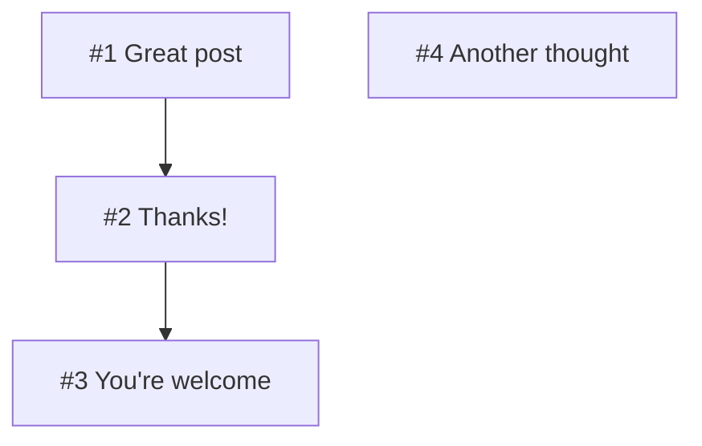

# 11 · Nested comments

[⬅ Index](./README.md) · [⬅ Prev](./10-posts-list-pagination-search.md) · [Next ➡ 12 Mount posts router](./12-mount-posts-router.md)

## 🎯 Goal

Let logged-in users comment on a post and reply to other comments, and let anyone read the comments as a **tree**.

## 🔖 Commits

| Hash | Message |
| --- | --- |
| `a125b74` | feat(comments): add nested comments support for posts |

## 🗂️ Files

| File | Action |
| --- | --- |
| `src/routes/posts.js` | tree helper + two comment routes added (+95 lines) |

## 🛠️ Walkthrough

### 1. Endpoints

| Method | Path | Auth | Success | Errors |
| --- | --- | :-: | :-: | --- |
| `POST` | `/posts/:postId/comments` | ✅ | `201` | 400, 401, 404 |
| `GET` | `/posts/:postId/comments` | public | `200` | 400, 404 |

### 2. Data model recap

`comments.parent_id` references `comments.id`:

| id | post_id | parent_id | body |
| :-: | :-: | :-: | --- |
| 1 | 5 | `NULL` | "Great post" |
| 2 | 5 | 1 | "Thanks!" |
| 3 | 5 | 2 | "You're welcome" |
| 4 | 5 | `NULL` | "Another thought" |



### 3. Helper: flat list → tree

Add above the comment routes in `src/routes/posts.js`:

```js
// Helper: Convert flat comments array into a nested tree structure
function buildCommentTree(comments, parentId = null) {
    const branch = [];
    for (const comment of comments) {
        if (comment.parent_id === parentId) {
            const replies = buildCommentTree(comments, comment.id);
            branch.push({
                ...comment,
                replies
            });
        }
    }
    return branch;
}
```

How it works:

1. Start with `parentId = null`, which gives the top-level comments.
2. For each match, call itself with `comment.id` to collect that comment's replies.
3. Attach them under a `replies` array.

> [!NOTE]
> The comparison `comment.parent_id === parentId` works because mysql2 returns SQL `NULL` as JS `null` and integers as numbers. Recursion depth equals thread depth, so it's fine for normal conversation sizes.

### 4. `POST /posts/:postId/comments`

```js
// POST /posts/:postId/comments - Add a comment (or reply) to a post
router.post('/:postId/comments', authenticate, async (req, res) => {
    const { postId } = req.params;
    const { body, parent_id } = req.body;

    // 1. Validate integer IDs
    if (!/^\d+$/.test(postId)) {
        return res.status(400).json({ error: 'Invalid post ID' });
    }
    const parentIdValue = parent_id !== undefined && parent_id !== null ? Number(parent_id) : null;
    if (parentIdValue !== null && (!Number.isInteger(parentIdValue) || parentIdValue < 1)) {
        return res.status(400).json({ error: 'Invalid parent comment ID' });
    }

    // 2. Validate comment content
    if (!body || typeof body !== 'string' || !body.trim()) {
        return res.status(400).json({ error: 'Comment body is required' });
    }

    // 3. Verify post exists
    const [posts] = await pool.query(`SELECT id FROM posts WHERE id = ?`, [postId]);
    if (posts.length === 0) {
        return res.status(404).json({ error: 'Post not found' });
    }

    // 4. If parent_id is provided, verify it belongs to the same post
    if (parentIdValue !== null) {
        const [parents] = await pool.query(
            `SELECT id FROM comments WHERE id = ? AND post_id = ?`,
            [parentIdValue, postId]
        );
        if (parents.length === 0) {
            return res.status(400).json({ error: 'Parent comment not found on this post' });
        }
    }

    // 5. Insert comment
    const [result] = await pool.query(
        `INSERT INTO comments (post_id, user_id, parent_id, body) VALUES (?, ?, ?, ?)`,
        [postId, req.user.id, parentIdValue, body.trim()]
    );

    res.status(201).json({
        id: result.insertId,
        post_id: Number(postId),
        user_id: req.user.id,
        parent_id: parentIdValue,
        body: body.trim()
    });
});
```

| Step | Why |
| --- | --- |
| Normalise `parent_id` to `Number` or `null` | Accepts "missing" and `null` as top-level, rejects `"abc"`, `1.5`, `0` |
| Check the post exists (404) | A clean error instead of a foreign-key failure |
| `WHERE id = ? AND post_id = ?` for the parent | **Prevents cross-post replies.** You can't attach a reply to a comment that lives on a different post |
| `user_id` from `req.user.id` | The author comes from the token, not the body |

### 5. `GET /posts/:postId/comments`

```js
// GET /posts/:postId/comments - Get nested comments tree for a post
router.get('/:postId/comments', async (req, res) => {
    const { postId } = req.params;

    if (!/^\d+$/.test(postId)) {
        return res.status(400).json({ error: 'Invalid post ID' });
    }

    // 1. Verify post exists
    const [posts] = await pool.query(`SELECT id FROM posts WHERE id = ?`, [postId]);
    if (posts.length === 0) {
        return res.status(404).json({ error: 'Post not found' });
    }

    // 2. Fetch all comments for this post
    const [comments] = await pool.query(
        `SELECT id, post_id, user_id, parent_id, body 
         FROM comments 
         WHERE post_id = ? 
         ORDER BY id ASC`,
        [postId]
    );

    // 3. Transform flat list into nested tree
    const tree = buildCommentTree(comments, null);

    res.json({ comments: tree });
});
```

> [!TIP]
> **One query, then build the tree in JS.** It avoids the N+1 problem of running a new query per reply level. `ORDER BY id ASC` keeps replies in chronological order inside each branch.

### 6. Example response

```json
{
  "comments": [
    {
      "id": 1, "post_id": 5, "user_id": 2, "parent_id": null, "body": "Great post",
      "replies": [
        {
          "id": 2, "post_id": 5, "user_id": 1, "parent_id": 1, "body": "Thanks!",
          "replies": [
            { "id": 3, "post_id": 5, "user_id": 2, "parent_id": 2, "body": "You're welcome", "replies": [] }
          ]
        }
      ]
    },
    { "id": 4, "post_id": 5, "user_id": 3, "parent_id": null, "body": "Another thought", "replies": [] }
  ]
}
```

## ✅ Verify

```bash
TOKEN="<token>"
H='Content-Type: application/json'

# top-level comment
curl -X POST localhost:3000/posts/1/comments -H "$H" -H "Authorization: Bearer $TOKEN" \
  -d '{"body":"Great post"}'

# reply to comment 1
curl -X POST localhost:3000/posts/1/comments -H "$H" -H "Authorization: Bearer $TOKEN" \
  -d '{"body":"Thanks!","parent_id":1}'

# read the tree
curl localhost:3000/posts/1/comments

# bad parent → 400
curl -X POST localhost:3000/posts/1/comments -H "$H" -H "Authorization: Bearer $TOKEN" \
  -d '{"body":"x","parent_id":999}'
# {"error":"Parent comment not found on this post"}
```

## ⚠️ Gotchas

- Comments have **no `created_at`** column in the simplified schema (removed in step 05), so the API can't show comment timestamps. Add `created_at TIMESTAMP DEFAULT CURRENT_TIMESTAMP` if you want them.
- There is no edit or delete for comments yet.
