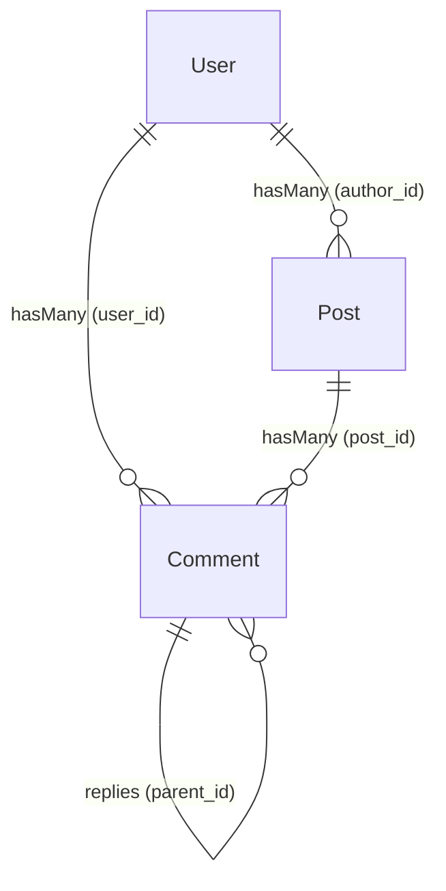

# 13 · ORM setup + models (Sequelize)

[⬅ Index](./README.md) · [⬅ Prev](./12-mount-posts-router.md) · [Next ➡ 14 Auth routes with ORM](./14-orm-auth-routes.md)

## 🎯 Goal

Stop writing raw SQL strings in every route. Describe the tables once as **models**, then query through them. The database and the public API stay **exactly the same**.

## 🔖 Commits

| Hash | Message |
| --- | --- |
| *(this migration)* | `refactor: migrate data layer from raw mysql2 queries to Sequelize` |

## 🗂️ Files

| File | Action |
| --- | --- |
| `package.json` | `sequelize` added |
| `src/config/db.js` | pool replaced by a Sequelize instance |
| `src/models/User.js` | created |
| `src/models/Otp.js` | created |
| `src/models/Post.js` | created |
| `src/models/Comment.js` | created |
| `src/models/index.js` | created (associations + exports) |
| `sql/schema.sql` | **unchanged** (models map onto the existing tables) |

## 🛠️ Walkthrough

### 1. Why Sequelize here

| Reason | Detail |
| --- | --- |
| Works with CommonJS | The project uses `require`, no build step needed |
| Uses the `mysql2` driver | Already installed, nothing to swap |
| Maps onto existing tables | No data migration, `schema.sql` keeps working |

### 2. Install

```bash
npm install sequelize
```

`mysql2` stays installed. Sequelize uses it under the hood.

### 3. `src/config/db.js`: replace the pool

```js
const { Sequelize } = require('sequelize');

const sequelize = new Sequelize(
    process.env.DB_NAME,
    process.env.DB_USER,
    process.env.DB_PASSWORD,
    {
        host: process.env.DB_HOST,
        dialect: 'mysql',
        logging: false,
        pool: { max: 10, min: 0, acquire: 30000, idle: 10000 },
        define: {
            timestamps: false,
            freezeTableName: true,
        },
    }
);

module.exports = sequelize;
```

| Option | Why |
| --- | --- |
| `pool` | Same idea as `connectionLimit: 10` before |
| `logging: false` | Turn on (`console.log`) to see every generated SQL statement while debugging |
| `timestamps: false` | Don't add `createdAt` / `updatedAt` columns that don't exist |
| `freezeTableName: true` | Don't pluralise or rename tables. Use the name exactly as written |

> [!NOTE]
> Sequelize sets the MySQL session time zone to `+00:00`. Because `NOW()` and `CURRENT_TIMESTAMP` run in that same session, the OTP time checks stay consistent.

### 4. Models

> [!IMPORTANT]
> Attribute names are **snake_case on purpose** (`author_id`, `created_at`). They match the column names, so no mapping layer is needed and the JSON responses don't change.

`src/models/User.js`

```js
const { DataTypes } = require('sequelize');
const sequelize = require('../config/db');

const User = sequelize.define('users', {
    id: { type: DataTypes.INTEGER, autoIncrement: true, primaryKey: true },
    phone: { type: DataTypes.STRING(11), allowNull: false, unique: true },
    role: { type: DataTypes.STRING(10), allowNull: false, defaultValue: 'author' },
});

module.exports = User;
```

`src/models/Otp.js`

```js
const { DataTypes } = require('sequelize');
const sequelize = require('../config/db');

const Otp = sequelize.define('otps', {
    id: { type: DataTypes.INTEGER, autoIncrement: true, primaryKey: true },
    phone: { type: DataTypes.STRING(11), allowNull: false },
    code_hash: { type: DataTypes.CHAR(64), allowNull: false },
    expires_at: { type: DataTypes.DATE, allowNull: false },
    attempts: { type: DataTypes.INTEGER, allowNull: false, defaultValue: 0 },
    used_at: { type: DataTypes.DATE, allowNull: true },
    created_at: { type: DataTypes.DATE, defaultValue: sequelize.literal('CURRENT_TIMESTAMP') },
});

module.exports = Otp;
```

`src/models/Post.js`

```js
const { DataTypes } = require('sequelize');
const sequelize = require('../config/db');

const Post = sequelize.define('posts', {
    id: { type: DataTypes.INTEGER, autoIncrement: true, primaryKey: true },
    author_id: { type: DataTypes.INTEGER, allowNull: false },
    title: { type: DataTypes.STRING(200), allowNull: false },
    body: { type: DataTypes.TEXT, allowNull: false },
    created_at: { type: DataTypes.DATE, defaultValue: sequelize.literal('CURRENT_TIMESTAMP') },
});

module.exports = Post;
```

`src/models/Comment.js`

```js
const { DataTypes } = require('sequelize');
const sequelize = require('../config/db');

const Comment = sequelize.define('comments', {
    id: { type: DataTypes.INTEGER, autoIncrement: true, primaryKey: true },
    post_id: { type: DataTypes.INTEGER, allowNull: false },
    user_id: { type: DataTypes.INTEGER, allowNull: false },
    parent_id: { type: DataTypes.INTEGER, allowNull: true },
    body: { type: DataTypes.TEXT, allowNull: false },
});

module.exports = Comment;
```

### 5. `src/models/index.js`: relationships + one import point

```js
const sequelize = require('../config/db');
const User = require('./User');
const Otp = require('./Otp');
const Post = require('./Post');
const Comment = require('./Comment');

User.hasMany(Post, { foreignKey: 'author_id' });
Post.belongsTo(User, { foreignKey: 'author_id' });

Post.hasMany(Comment, { foreignKey: 'post_id' });
Comment.belongsTo(Post, { foreignKey: 'post_id' });

User.hasMany(Comment, { foreignKey: 'user_id' });
Comment.belongsTo(User, { foreignKey: 'user_id' });

Comment.hasMany(Comment, { as: 'replies', foreignKey: 'parent_id' });
Comment.belongsTo(Comment, { as: 'parent', foreignKey: 'parent_id' });

module.exports = { sequelize, User, Otp, Post, Comment };
```



> [!TIP]
> Always import models from `../models`, never from the individual files. That guarantees the associations in `index.js` are registered before any query runs.

### 6. SQL → ORM quick reference

| Raw SQL (before) | Sequelize (after) |
| --- | --- |
| `SELECT ... WHERE id = ?` | `Model.findByPk(id)` |
| `SELECT ... WHERE a = ? LIMIT 1` | `Model.findOne({ where: { a } })` |
| `SELECT ... ORDER BY id DESC` | `Model.findAll({ order: [['id', 'DESC']] })` |
| `INSERT INTO ...` | `Model.create({ ... })` |
| `UPDATE ... WHERE ...` | `Model.update({ ... }, { where })` → `[affectedRows]` |
| `DELETE ... WHERE ...` | `Model.destroy({ where })` → count |
| `LIKE '%q%'` | `{ [Op.like]: '%q%' }` |
| `a OR b` | `{ [Op.or]: [a, b] }` |
| `COUNT(*)` + rows | `Model.findAndCountAll({ ... })` |
| `NOW() - INTERVAL 60 SECOND` | `literal('NOW() - INTERVAL 60 SECOND')` |
| `attempts = attempts + 1` | `{ attempts: literal('attempts + 1') }` |

## ✅ Verify

The models alone don't change behaviour yet. The next steps switch the routes over. Quick check that the connection works:

```bash
node -e "require('dotenv').config(); require('./src/config/db').authenticate().then(() => console.log('connected')).catch(e => console.error(e.message))"
# connected
```

## ⚠️ Gotchas

- Don't call `sequelize.sync()`. The tables already exist from `schema.sql`, and `sync({ force: true })` would **drop your data**.
- If a model attribute name doesn't match a real column, you get `Unknown column` errors at query time.
