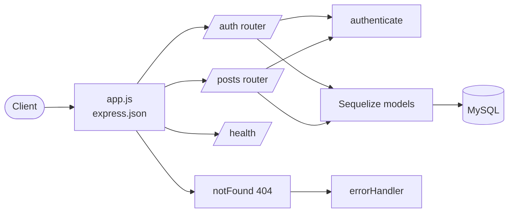
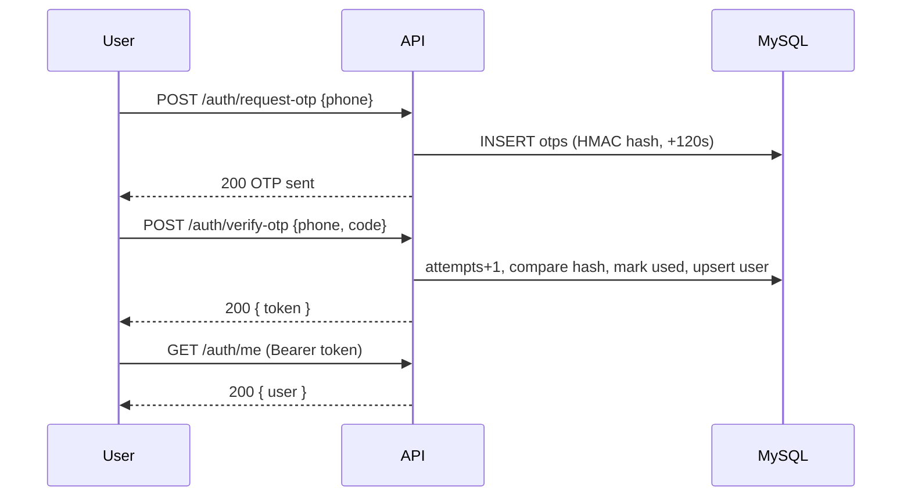

<div align="center">

# 🗺️ simple-weblog — Build Roadmap

**A step-by-step roadmap of the whole project, commit by commit.**
Node.js · Express 5 · MySQL · Sequelize ORM · OTP login · JWT · Posts · Nested comments

</div>

---

## How to use this

This folder is a **replay script**. Follow the steps in order, from an empty folder to the finished API. Each step matches one or more real commits in this repo, so you can always compare with `git show <hash>`.

Every step page has the same layout:

| Section | What it gives you |
| --- | --- |
| 🎯 **Goal** | What this step adds and why |
| 🔖 **Commits** | The matching git commit(s) |
| 🗂️ **Files** | Files created or changed |
| 🛠️ **Walkthrough** | Numbered actions with code boxes |
| ✅ **Verify** | A command to prove it works |
| ⚠️ **Gotchas** | Mistakes made along the way, so you can skip them |

> [!NOTE]
> **Two versions of the data layer.** Steps 00 to 12 build the API with raw `mysql2` queries, so you see exactly what SQL runs. Steps 13 to 16 migrate that same API to the **Sequelize ORM**. Endpoints, responses and the database schema don't change. Stop at step 12 if you want the raw-SQL version.

> [!TIP]
> Don't copy blindly in a live session. Read the **Goal**, type the code yourself, then use the **Verify** block to check.

---

## 🧭 Roadmap

| # | Step | Commit(s) | You end up with |
| :-: | --- | --- | --- |
| 00 | [Project init](./00-project-init.md) | `557d01c` | Empty repo, `package.json`, `src/app.js` |
| 01 | [Hello-world server + env](./01-hello-server-and-env.md) | `f341391` | Plain `http` server, `.env`, `.gitignore`, deps |
| 02 | [Database schema + pool](./02-database-schema-and-pool.md) | `79f2c63`, `f72abbc` | `users`/`posts`/`comments` tables, MySQL pool |
| 03 | [Express app / server split](./03-express-app-and-server.md) | `e222096`, `c5eade3`, `a9e5b47` | `app.js` + `server.js`, health routes, `--watch` |
| 04 | [Error handling](./04-error-handling.md) | `29a39a0`, `fb159e7` | `notFound` + MySQL-aware `errorHandler` |
| 05 | [OTP table + simpler schema](./05-otps-table-and-schema-simplify.md) | `289fd3c`, `5b815b3`, `38cfa28` | `otps` table, `OTP_SECRET` check |
| 06 | [Request OTP](./06-request-otp.md) | `3eaeaf7` | `POST /auth/request-otp` with cooldown |
| 07 | [Verify OTP + JWT](./07-verify-otp-and-jwt.md) | `1529431` | `POST /auth/verify-otp` returns a token |
| 08 | [Auth middleware + `/me`](./08-auth-middleware.md) | `6c2750b` | `authenticate`, `requireAdmin`, `GET /auth/me` |
| 09 | [Posts CRUD](./09-posts-crud.md) | `cebd2ce` | create / read / update / delete posts |
| 10 | [Posts list: pagination + search](./10-posts-list-pagination-search.md) | `cebd2ce` | `GET /posts?page=&limit=&q=` |
| 11 | [Nested comments](./11-nested-comments.md) | `a125b74` | threaded comments on posts |
| 12 | [Mount posts router](./12-mount-posts-router.md) | included in the ORM commit | `/posts` wired into `app.js` |
| 13 | [ORM setup + models](./13-orm-setup-and-models.md) | ORM migration | Sequelize instance, 4 models, associations |
| 14 | [Auth routes with ORM](./14-orm-auth-routes.md) | ORM migration | OTP + JWT login rewritten with models |
| 15 | [Posts routes with ORM](./15-orm-posts-routes.md) | ORM migration | posts, list, comments rewritten with models |
| 16 | [ORM errors + wiring](./16-orm-errors-and-wiring.md) | ORM migration | Sequelize-aware errors, `app.js`/`server.js` switched |
| 🏁 | [Final reference](./99-final-reference.md) | — | Tree, API table, env, curl script, known quirks |

---

## 🏗️ Architecture at a glance





---

## 🧰 Stack

| Piece | Choice | Why |
| --- | --- | --- |
| Runtime | Node.js (uses `node --watch`, so Node 18+) | No nodemon needed |
| Web framework | `express@^5` | Async handlers forward rejected promises to the error handler |
| Database | MySQL via `mysql2` | Raw `pool.query(...)` in steps 00-12 |
| ORM | `sequelize` (steps 13-16) | Models instead of SQL strings, same API |
| Auth | Phone + OTP, then JWT (HS256, 1h) | Passwordless |
| OTP storage | HMAC-SHA256 hash, never the plain code | A DB leak does not leak codes |
| Config | `dotenv` | Secrets stay out of git |

> [!NOTE]
> Express 5 catches errors thrown (or rejected) inside `async` route handlers. That is why none of the routes here need `try/catch` around DB calls.

---

## ⚡ Quick start (after finishing all steps)

```bash
npm install
cp .env.example .env          # then fill in the values
mysql -u <user> -p simple_weblog < sql/schema.sql
npm run dev
```

```bash
curl http://localhost:3000/health
# {"status":"ok"}
```
